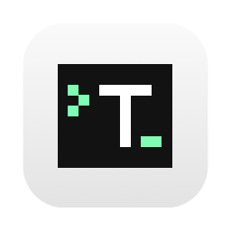
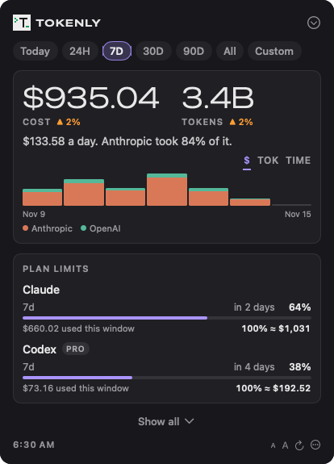

# Tokenly

**What your AI coding really costs.** A tiny macOS menu bar app (plus a one-file CLI) for **Claude Code** and
**Codex**: cost at API list prices, live plan limits, and where your tokens go, read from the logs on your Mac.

[Website](https://longado.github.io/tokenly/) · [Download for macOS](https://github.com/Longado/tokenly/releases/latest/download/Tokenly.zip) · [Roadmap](ROADMAP.md)



## Features

**At a glance** (the panel opens folded)
- Cost and tokens for the period, each with the change from the previous period, plus a one-line summary.
- Trend bars by hour, day or month, split by provider; switch between cost, tokens and active time.
- Live plan limits for Claude and Codex: plan badge, % used, time to reset, reset credits, a warning when you're
  on pace to run out, what 100% of a limit is worth, and what your plan is worth vs its price ("44×").
- Each plan shows when its reading was taken. If a check fails, that plan shows the cause and uses the newest
  saved reading with a limit window that is still active.

**Unfolded ("Show all")**
- Breakdown by provider, model, project, device or day; click any row to filter the whole panel.
- Token mix (input / output / cached / cache writes) with cache hit rate and savings.
- Plan weeks: cost per 7-day window, full limits used, and resets detected.
- 13-week activity calendar and every month on record.

**Periods:** Today, 24H, 7D, 30D, 90D, All, a custom From–To range, or Since Codex reset. The reset range
shows Codex usage from the current weekly allowance's reset time, including other devices when enabled.

**Yours to tune:** menu bar format (cost, tokens, two lines, or fullest plan limit), plan-limit alert, which
sections the overview shows, text size, solid or glass background, plan prices, model prices, launch at login, and
an optional desktop widget.

## Install

1. Download [Tokenly.zip](https://github.com/Longado/tokenly/releases/latest/download/Tokenly.zip) and unzip it.
2. Move `Tokenly.app` to Applications.
3. Open it with right-click → Open the first time (the app is ad-hoc signed, not notarized).
4. Click the menu bar icon. Settings → General → Launch at login, if you like.

macOS 13 or later, Apple silicon or Intel.

## Privacy

Tokenly reads the session logs Claude Code and Codex already write. It uploads nothing and needs no account.
It makes only these requests, each of which can be turned off in Settings:

| What | How | Default |
|---|---|---|
| Live Codex limit | `GET chatgpt.com/backend-api/wham/usage` with the Codex login in `~/.codex/auth.json`, at most every 2 min automatically and on manual refresh | on |
| Live Claude limit | runs Claude Code in a safe, tool-less mode and asks `get_usage`: no prompt, no tokens, at most every 5 min | on |
| Other devices | read-only download from your own Vibe Usage account, if that app is linked. Since Codex reset requests usage from the reset time. | off |

Logins are read per request, sent only to their own service, and never stored or logged.

## Command line

```bash
pipx install git+https://github.com/Longado/tokenly   # or: python3 tokenly.py
tokenly                  # last 30 days by day / provider / model / project
tokenly 7 --by provider  # one grouping: day | provider | model | project | all
tokenly --quota          # plan limits as last recorded locally
tokenly --json           # machine-readable (also with --quota)
```

## Pricing

Costs are **API list-price equivalents**, not what a subscription charges. Defaults live in `tokenly.py` (`PRICES`)
and `macos/main.swift` (`defaultPrices`); a test keeps them identical. Override or add models in
`~/.config/tokenly/prices.json`, read by both the app and the CLI. Its five amounts are USD per million tokens
for input, output, cache reads, default cache writes, and extended cache writes. Claude uses 5-minute and
1-hour write rates. GPT-6.2 uses 30-minute and 12-hour write rates. Codex logs that only report a write count
use the default duration. Local GPT-6.2 requests above 272,000 input tokens use the long-context rate with
the built-in prices. Settings → Pricing → Edit Prices… opens the file.

```json
{ "my-model": [1.0, 5.0, 0.1, 1.25, 2.0] }
```

Model names are normalized first (router prefixes, `[1m]` tags, date snapshots, and effort suffixes when that
matches a priced model), so variants of one model share a price.

## Keeping history

Claude Code deletes session logs after 30 days by default. To keep your history, set
`"cleanupPeriodDays": 3650` in `~/.claude/settings.json` on every Mac you use. Plan readings are kept by Tokenly
itself in `~/Library/Application Support/Tokenly/`.

## Data sources

| Data | Source |
|---|---|
| Claude Code usage | `~/.claude/projects/**/*.jsonl` (`message.usage`, deduped by message id + request id) |
| Codex usage | `~/.codex/sessions/**/*.jsonl` (`token_count` → `last_token_usage`, cached input split out) |
| Claude plan limit | live `get_usage`, else `cachedUsageUtilization` in `~/.claude.json` |
| Codex plan limit | live usage endpoint, else Vibe Usage's saved reading, else `rate_limits` in Codex logs |

`$CLAUDE_CONFIG_DIR` and `$CODEX_HOME` are respected.

The macOS app also reads Codex's archived sessions and uses `zstd` on `.jsonl.zst` logs when available.
Monthly usage keeps tokens for models without prices and marks the API cost estimate as incomplete.
Plan weeks use saved limit readings, even when a current limit cannot be refreshed.

## Development

```bash
macos/build.sh                          # universal Tokenly.app + zip (Xcode command line tools only)
python3 -m unittest discover -s tests   # CLI and price-table tests
TOKENLY_DEMO=1 macos/build/Tokenly.app/Contents/MacOS/Tokenly --snapshot out.png week --popover
```

`--snapshot out.png [today|24h|week|month|90d|all|custom from=… to=…|dayN] [--popover|--settings] [page=all]
[--tall] [provider=…] [model=…] [project=…] [device=…] [mode=…] [hover=N]` renders the panel to a PNG;
`TOKENLY_DEMO=1` uses made-up data.

Run the macOS history regression test with `zstd` installed.

```bash
tokenly_test_dir=$(mktemp -d)
swiftc -D TOKENLY_HISTORY_TESTS macos/main.swift tests/macos_history.swift -o "$tokenly_test_dir/history-test"
CFFIXED_USER_HOME="$tokenly_test_dir" CODEX_HOME="$tokenly_test_dir/codex" \
  CLAUDE_CONFIG_DIR="$tokenly_test_dir/claude" "$tokenly_test_dir/history-test"
```

## License

MIT
